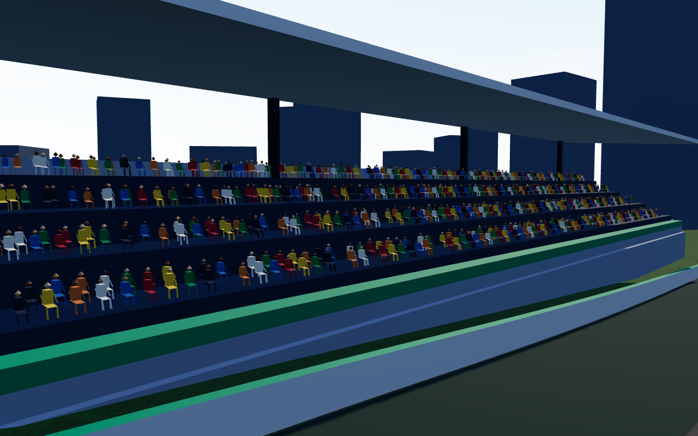
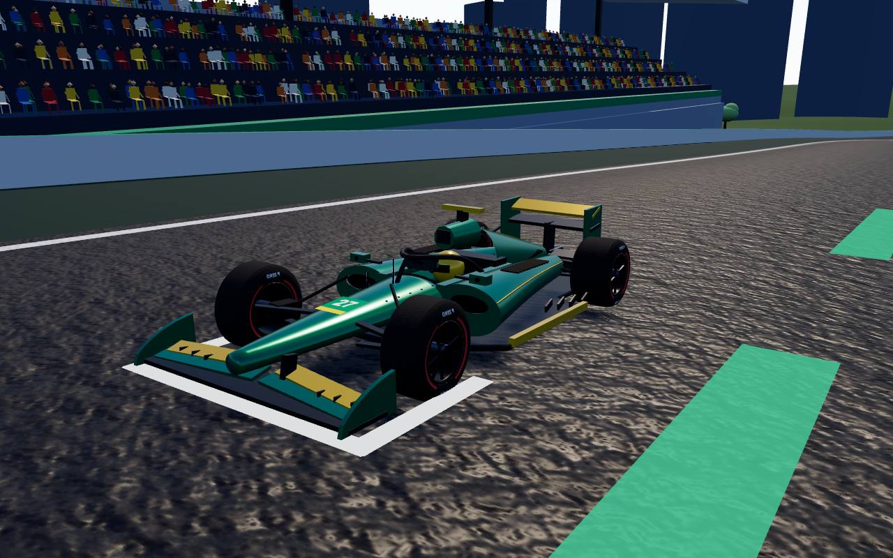
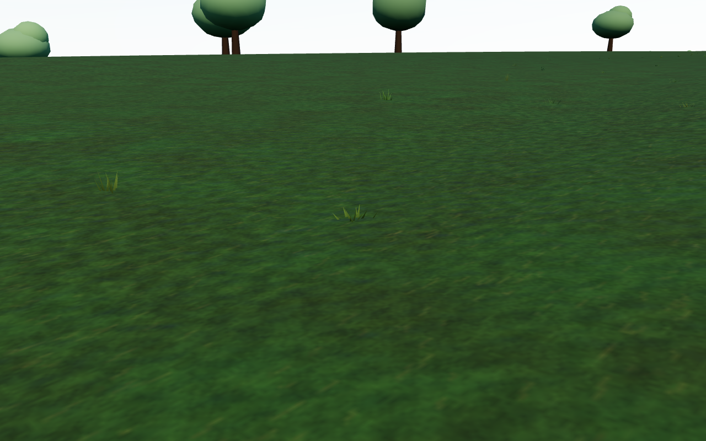

# Parte 7 — plateia, colisões, grama e carro piloto

Implementação web de 18/11/2026. Skills aplicadas: physics-tuning, threejs-materials-lighting e performance-optimization. O projeto Godot permanece separado.

## Testar agora

O servidor de produção desta entrega está na porta 3007. Para executar o ZIP extraído por conta própria, dentro da pasta nova:

```sh
npm ci
npm run dev -- --port 3007
```

Abra a URL exibida pelo Terminal. Se a porta estiver ocupada, use outra porta e abra a URL correspondente. Uma aba de uma versão anterior não muda automaticamente para a pasta extraída.

1. Inicie uma corrida em Interlagos. Na reta dos boxes, veja a arquibancada em T-Cam ou TV Pista: o público deve estar sentado nos degraus, sem as antigas faixas inclinadas suspensas.
2. Na câmera Chase, examine o carro do jogador: nariz, pontões e cobertura do motor curvos; entradas de ar, respiros, suportes, hastes e ferragens adicionais. Só o jogador recebeu essa revisão de carroceria.
3. Compare um contato quase paralelo ao muro com uma batida inclinada, inicialmente em baixa velocidade. A colisão deve tirar velocidade e gerar giro conforme o contato, sem alinhar automaticamente o nariz à pista.
4. Bata no poste de uma placa de frenagem acessível na faixa de escape pavimentada: a placa deve tombar e permanecer caída até reiniciar a sessão. Os pilares do pórtico são sólidos. O motor não deve parar como se tivesse atingido uma parede ao acertar uma placa leve.
5. Batidas mais fortes na frente/traseira acumulam dano aerodinâmico. O HUD mostra os percentuais; as asas ficam desalinhadas e há perda de carga aerodinâmica. Reiniciar a sessão repara o carro e repõe as placas.
6. Observe a grama existente além dos muros: textura contínua entre talude e terreno, palha, manchas e tufos com alturas e tons variados. Não foram criadas zonas de escape fictícias nem deslocados muros para alcançar a grama.

I liga/desliga; T alterna manual/automático; Q reduz; E sobe. Pausa conserva os controles de chuva, adversários, superfícies e motor. Os 17 arquivos de áudio são idênticos aos da Parte 6.

## O que mudou

### Plateia

A causa da imagem enviada estava em `trackBuilder.ts`: planos de público com comprimento de arquibancada, inclinados em X e girados 90° em Z. Em vez de espectadores sobre os degraus, formavam faixas grandes atravessando o volume da estrutura.

`circuitDetails.ts` cria espectadores sentados, com corpo e cabeça, cores e ocupação variadas e intervalos de circulação. São dois InstancedMesh por arquibancada. Interlagos tem 2.980 espectadores nas quatro estruturas existentes. As posições são as do cenário anterior, sem alegação de levantamento arquitetônico real das arquibancadas.

### Colisões e mecânica de dano

- **Muros:** três discos ao longo do carro representam um casco horizontal aproximado de 5,26 × 1,96 m. O contato considera as extremidades, corrige penetração e aplica impulso no ponto de contato com inércia angular e atrito tangencial. Retirado o alinhamento artificial do nariz ao muro. A malha dos muros permanece na posição anterior.
- **Placas e pórtico:** `scenery.ts` fornece as mesmas coordenadas para visual e colisão. Há 24 elementos em Interlagos: placas/postes que cedem e dois pilares rígidos. Os postes usam varredura de disco para capturar cruzamentos entre passos. A face elevada das placas não vira uma parede invisível de altura total; o contato do carro baixo é com o poste.
- **Elementos leves:** transferência de momento usa massa efetiva pequena e o objeto tomba sobre sua base. O estado pertence à sessão, é compartilhado por todos os carros, pausa com o jogo e reinicia sem carregar placas quebradas da demonstração. Objetos já tombados deixam de ser obstáculos ativos.
- **Dano:** impactos com componente normal acima do limiar acumulam dano frontal/traseiro entre 0 e 100%. O teto de perda de carga é 18% pela frente e 16% pela traseira. Há indicação no HUD e inclinação visual das asas. O teste confirma maior distância de frenagem com dano.

**Limites físicos importantes:** é um modelo de impulsos em 2D, com altura da pista imposta. Não há deformação estrutural, peças destacáveis com dinâmica própria, capotamento, suspensão destrutível ou simulação de absorção por barreira TecPro/pneus. Dano e coeficientes são empíricos. Restituição 0,035 e atrito 0,28 no concreto, massas efetivas de 3/5 kg para placas e círculo conservador em torno dos pilares são hipóteses de jogo, não medições de objetos reais de Interlagos.

Prédios, árvores e arquibancadas continuam protegidos pelos muros contínuos; não receberam colisores individuais acessíveis. Colisões carro–carro continuam com o modelo anterior de três círculos, com casco um pouco mais curto; unificar esse casco e aprofundar dano entre carros é uma pendência. Não apresentar esta entrega como uma física estrutural real de F1.

### Grama

5.489 tufos instanciados em Interlagos, divididos em blocos para permitir descarte pela câmera. As raízes usam os triângulos existentes do talude e o terreno; candidatos sobre a pista/faixa pavimentada são descartados. Lâminas estreitas, alturas e verdes variáveis complementam a textura de solo/palha.

Foi corrigida a escala de UV: anteriormente, talude e terreno usavam o mesmo material com escalas espaciais muito diferentes, deixando uma emenda evidente. Agora ambos usam coordenadas de mundo na mesma escala. Não foi alterada a localização da grama, a geometria da pista nem o mapa de superfícies. A aderência da grama mantém os parâmetros anteriores; o som aprovado não mudou.

### Carro piloto e Blender

Carroceria do jogador com lofts arredondados no nariz, pontões e cobertura do motor; bocas de entrada de ar com rebaixo visual, linhas de acabamento, respiros, hastes adicionais, lentes de câmera e pequenas ferragens. Ferragens estáticas são agrupadas por material, e o restante do grid mantém o nível anterior. A aparência foi conferida em renderização real do jogo.

O arquivo `kit-blender/carro-piloto-fase7.glb` está incluído no ZIP. É a exportação do modelo efetivamente usado no jogo, com materiais e oito imagens incorporadas, cerca de 2,19 MB. Pode servir como base para modelagem no Blender. Não é um arquivo .blend, uma digitalização ou réplica geométrica de uma equipe.

A direção técnica considera a [ficha oficial da McLaren MCL40](https://www.mclaren.com/racing/formula-1/2026/what-is-the-technical-specification-of-our-2026-formula-1/), que identifica carroceria composta, pontões, asas, halo e elementos de suspensão. A fonte orienta os componentes visíveis; não fornece cotas suficientes para reconstruir a superfície do carro. As imagens que você enviou continuam sendo direção estética, sem serem tratadas como desenhos ortográficos medidos.

**Era e dimensões continuam pendentes:** o jogo mantém massa de 798 kg, DRS e sistema híbrido simplificado. O entre-eixos visual herdado é 3,10 m e o modelo físico usa 3,60 m. A carroceria desta etapa preserva o conjunto existente e não resolve essa inconsistência. Definir as cotas do carro piloto e converter física/aerodinâmica/regras em conjunto será necessário para chamá-lo de F1 2026 fiel.

## Verificação executada

```sh
npm run lint
npm test
npm run build
npm run check:geom
npm run benchmark:dynamics
```

- **63 testes passaram.** Novos testes cobrem impulsos/energia, giro fora do centro, detecção de postes, placas leves, pausa/reinício, casco no muro, dano/telemetria e perda de capacidade de frenagem; também verificam público sobre os degraus, grama fora do asfalto, normais do nariz e orçamento das malhas novas.
- O teste de ciclo do Time Trial passou a usar a IA real a 180 Hz. O controlador simplificado anterior dependia da antiga assistência de muro e deixou de servir como teste do ciclo da sessão.
- `lint`, build e `check:geom` passaram em Interlagos, Monza e Spa. A checagem de carro existente cobre o conjunto compartilhado; os novos volumes do piloto têm testes próprios de geometria, sem comprovação de precisão topográfica ou automotiva.
- Todos os samples da pista, incluindo posições, largura, banco e zebras, são idênticos aos da Parte 6. Só os UVs da grama e os elementos descritos foram revisados no cenário.
- As voltas solo do benchmark permanecem iguais às da Parte 6: competitivo seco aproximadamente 1:21,87; pro aproximadamente 1:19,16. O comportamento longe de colisões não foi recalibrado. A IA segue conservadora e a calibração para ritmo real permanece pendente.
- Chrome: partida/manual, controles de chuva/rivais, dano no HUD e placa caída funcionaram sem exceções JavaScript no teste final.
- GLB exportado e recarregado no navegador pelo GLTFLoader: 99 malhas carregadas, 36 com mapas de cor. Cabeçalho e estrutura do arquivo válidos. A importação dentro do aplicativo Blender não foi executada.
- Após três ciclos Monza → Spa → Interlagos, contagens estabilizadas em 141 geometrias e 40 texturas. Corrigido o descarte das geometrias de estruturas e buffers de instâncias na troca de cenário. Essas contagens não são uma medida de toda a memória do processo.

### Custo visual medido

Build de produção, Chrome headless, ANGLE Metal / Apple M5, 1280×800, T-Cam na largada, simulação congelada. Três amostras por versão, 90 intervalos de apresentação por amostra:

| Métrica | Parte 6 | Parte 7 |
|---|---:|---:|
| Desenhos por quadro | 1.408 | 1.431 |
| Triângulos por quadro | 1.067.444 | 1.202.062 |
| FPS observado | 60 | 60 |
| p95 dos intervalos de apresentação | 16,7–16,8 ms | 16,7–16,8 ms |

O custo subiu aproximadamente 12,6% em triângulos e 1,6% em chamadas. A apresentação está limitada à cadência do monitor; isso não mede folga de GPU nem comprova 60 FPS em corrida, chuva, outros computadores ou uso prolongado. Não foi reduzido o conteúdo da cena para renderização por software. No smoke test breve com SwiftShader, a cena renderizou sem perda de contexto e sem exceções JavaScript, mas o contador observado foi de 1 FPS. Esse resultado não é jogável; software continua abaixo de 10 FPS e pode descartar tempo físico pelo acumulador. Não se trata de um teste de desempenho prolongado.

O JavaScript principal permanece grande: aproximadamente 1,056 MB minificado / 295 kB gzip. O exportador GLB fica em um módulo separado carregado sob demanda no diagnóstico, cerca de 38 kB minificado. O aviso de bundle e o aviso de configuração futura do Vite continuam presentes. Nenhuma biblioteca nova foi instalada.

## Relatórios e continuação

`validacao-visual-parte7.json`, `validacao-ciclo-parte7.json`, `validacao-modelo-parte7.json`, `validacao-colisoes-parte7.json`, `validacao-fisica-parte7.json`, `validacao-assets-parte7.json`, `validacao-software-parte7.json` e `validacao-parte7.json`.

Recordes/ghosts agora usam `physics-v4` por causa das mudanças nas colisões/dano. Os registros anteriores continuam armazenados, separados da nova física.

Próxima prioridade técnica: unificar cotas do piloto e colisores entre carros; definir a era do conjunto; aprofundar o modelo piloto no Blender; calibrar a IA por trecho. A pista real, os objetos de entorno acessíveis e danos estruturais exigem validações próprias antes de ampliar o escopo.


## Capturas da implementação






