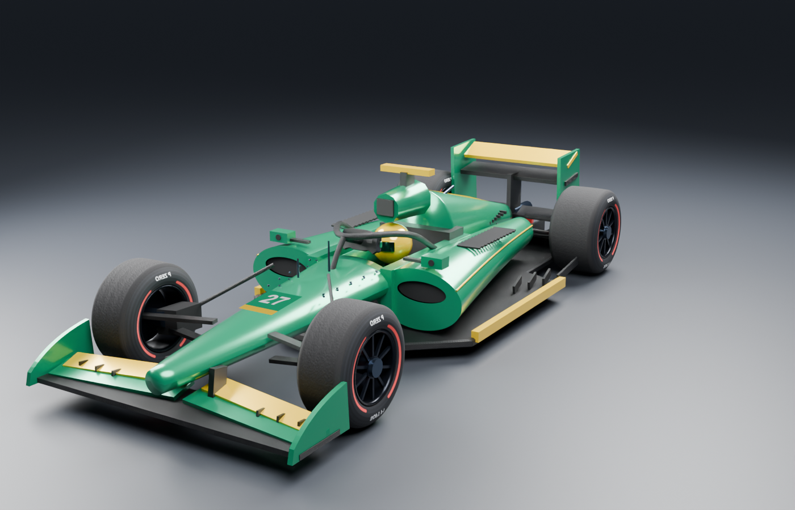
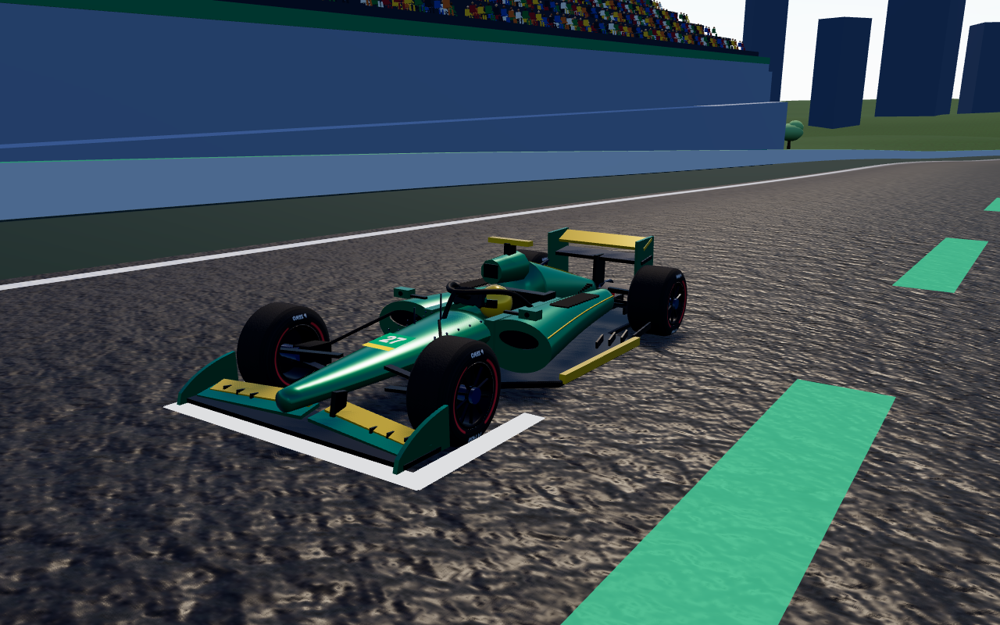
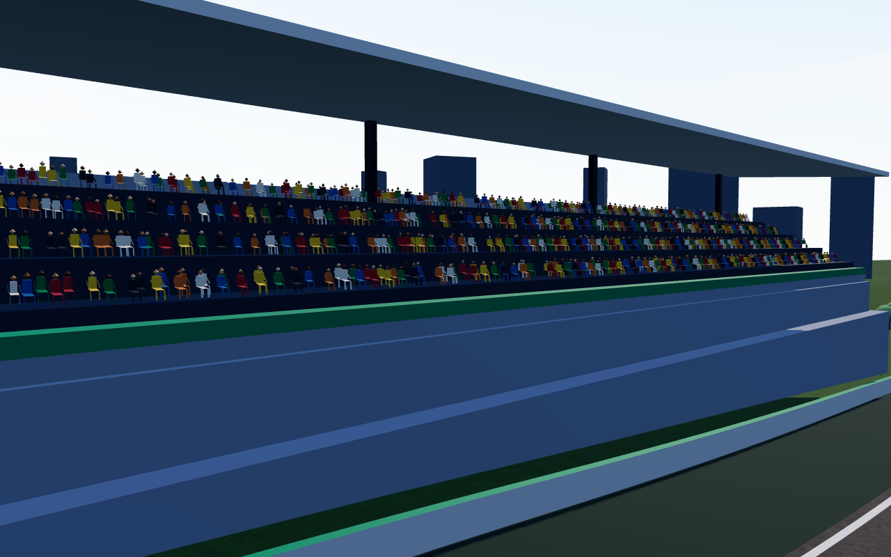

# Fase 8 — Blender integrado, motor e estruturas do circuito

Entrega de 18/11/2026, versão web. Use o ZIP desta fase em uma pasta nova. Para executar: `npm ci` e `npm run dev -- --port 3008`; abra a URL exibida. A versão Godot permanece separada.

## Carro editável e integração real

`kit-blender/fase-8/Auriverde-Piloto-Fase8.blend` é o arquivo nativo, criado e reaberto no Blender 5.3 com oito imagens incorporadas e sem imagens externas faltantes. Inclui estúdio para renderização e uma referência de colisão auxiliar. O piloto foi refinado a partir do protótipo da fase 7: acabamento das asas, carroceria, fechamento da cobertura do motor, materiais, ferragens, LEDs e posições de suspensão/eixos.

O jogo agora carrega `public/models/pilot-v8.glb` pelo GLTFLoader para o jogador. Rodas, direção, volante, LEDs, câmeras, número/pintura e flap permanecem controlados pelo jogo. O adaptador recompõe pivôs no referencial do jogo, preserva o OLED da telemetria e os efeitos de rodas. Em falha de carregamento/contrato, mantém o piloto procedural disponível e registra o erro no console. O restante do grid mantém a modelagem anterior.

O modelo tem **59.013 triângulos**, limites visuais medidos de aproximadamente **2,007 × 1,098 × 5,007 m** e entre-eixos de **3,60 m**, agora coerente com o valor físico atual. É um piloto autoral do simulador, não uma reconstrução medida de uma equipe. Massa de 798 kg, DRS e sistema híbrido simplificado continuam heranças do jogo; esta fase não implementa todas as regras de 2026. A [referência oficial da F1 para 2026](https://www.formula1.com/en/latest/article/fia-unveils-formula-1-regulations-for-2026-and-beyond-featuring-more-agile.75qJiYOHXgeJqsVQtDr2UB) descreve dimensões diferentes; não apresentamos o arquivo como réplica regulamentar daquela geração.

Para continuar a modelagem e exportar de volta, siga `kit-blender/fase-8/LEIA-ME.md`. Há um exportador Python pronto, fonte intermediária nomeada e manifesto de validação. A leitura e exportação foram executadas no Blender; o GLB também foi carregado e verificado dentro do jogo. A validação glTF terminou **sem erros e sem avisos**, com informações sobre atributos/nós auxiliares sem uso visual. Quatro tangentes nulas em polos UV foram corrigidas por uma etapa reproduzível após a exportação.

## Motor: causa da repetição e correção

O arquivo anterior continha cerca de **0,9 s** de uma aceleração. Cada repetição trazia a mesma subida de tom. Além disso, o código limitava a afinação a 0,8–1,12: várias rotações baixas recebiam a mesma taxa, apesar de o RPM da física variar.

Foi reutilizado exclusivamente o trecho autorizado do seu `verstappen_onboard.wav`, dentro da região que já alimentava a fase 5. A edição usa 18 fragmentos gravados, estabilização de uma componente tonal de referência, nivelamento e sobreposição com janelas Hann. Três texturas alternativas de **7,92 s** são misturadas lentamente com ganho de energia constante. A taxa agora responde continuamente ao RPM, com referência de edição em 10.500 rpm; ela **não certifica o RPM da gravação original**. Não foram criados osciladores nem sons de combustão sintetizados.

Áudio de motor em jogo ainda usa gravações repetidas, como é habitual nesse tipo de sistema. A correção reduz a repetição curta perceptível; não há promessa de áudio infinito ou de identidade comprovada de um V6 2026. Em rotação constante, a correlação no antigo intervalo de 0,9 s caiu de 1,0 na repetição antiga para aproximadamente -0,002 no demonstrativo. Essa medida comprova redução daquela repetição exata, não substitui sua escuta.

O demonstrativo `motor-fase8-demonstracao.wav`, entregue separadamente, foi renderizado pelo próprio RecordedAudioEngine: aceleração, trecho constante, desaceleração e nova aceleração. Duração 20 s, pico verdadeiro aproximadamente -19,5 dBFS e loudness integrado -31 LUFS, somente motor com os demais barramentos silenciados. São valores do demonstrativo isolado, não da mixagem inteira do jogo. Memória dos buffers decodificados: **11.736.928 bytes**, abaixo de 64 MiB. `engineReady=false` permanece correto: este conjunto é experimental e não contém seis bandas com RPM de origem certificados.

Testes de Web Audio verificaram motor/menu com o mesmo sinal de referência, volume zero e mudo silenciosos, motor desligado silencioso, chuva e rivais controláveis e adversário próximo mais audível que distante. As gravações de zebra, asfalto, chuva e demais efeitos existentes foram preservadas; os arquivos alterados são os do onboard e seus registros de origem. Créditos, hashes e edições estão em `public/audio/fontes-parte-8.json` e `fontes-e-edicoes.json`.

## Prédios e arquibancadas

A inspeção de área ocupada encontrou **três volumes antigos incompatíveis com o corredor de Interlagos**: o conjunto de boxes e dois prédios do skyline. Também encontrou conflitos nos cenários de Monza e Spa. Conferir apenas o ponto central de um prédio não bastava para detectar uma construção longa atravessando uma curva próxima.

`sceneryPlacement.ts` agora verifica o retângulo completo de cada estrutura contra pista, faixa pavimentada, muro e uma margem adicional que cobre o espaçamento das amostras. O skyline foi afastado para fora do circuito e permanece dentro do terreno gerado. Boxes e arquibancadas são reposicionados por esse critério e também evitam se sobrepor. Árvores candidatas dentro dessas estruturas são descartadas. Isso corrige o cenário existente; essas posições decorativas **não são cotas ou localizações reais levantadas de Interlagos**.

As bases das arquibancadas e boxes passam a consultar a altura dos triângulos efetivamente renderizados no terreno, em vez de apenas uma altura central aproximada. Fundações seguem o terreno nas extremidades e se sobrepõem ao embasamento, fechando o vão que dava a aparência de flutuação. Os trechos foram agrupados em cinco malhas, com normais de faces planas. Público e degraus permanecem sobre a mesma estrutura.

Todos os cinco grandes conjuntos e os 68 prédios decorativos de Interlagos passaram no verificador conservador. O mesmo teste passou para os conjuntos de Monza e Spa. Não foram movidos traçado, muros ou zebras, nem criadas novas zonas de escape. A física de colisão da fase 7 continua em vigor.

## Validação e limites

```sh
npm run lint
npm test
npm run build
npm run check:geom
npm run check:scenery
npm run benchmark:dynamics
```

**68 testes passaram**, cobrindo agora contrato do GLB, nós, imagens incorporadas, entre-eixos, resposta do motor ao RPM, mistura de texturas, área ocupada dos prédios e apoios sobre o terreno. Lint, build, check:geom e check:scenery passaram. As voltas de IA permanecem as da fase 7, aproximadamente 1:21,87 no competitivo seco; não houve nova calibração de ritmo.

No Chrome, o piloto do Blender carregou sem exceções JavaScript e com rodas/direção controláveis; cockpit, T-Cam e Chase foram inspecionados. As capturas anexas mostram a implementação em execução. Verificação de troca de clima, controles e repetição de trocas de pista fica registrada no relatório de ciclo. Contagens de GPU e FPS instantâneo são diagnósticos, não comprovação de desempenho sustentado em corrida. A primeira compilação dos novos materiais pode causar pausa de carregamento.

A compatibilidade por software permanece limitada pelo custo geral da cena, já observado nas fases anteriores. Esta entrega não resolve a otimização completa do grid. O bundle principal continua acima de 500 kB e o aviso de configuração futura do Vite permanece. O loader GLB é separado em módulo carregado sob demanda. Nenhuma dependência foi adicionada ao package.json para essa integração; a validação glTF usou ferramenta de diagnóstico fora das dependências do projeto.

Relatórios: `validacao-blender-parte8.json`, `validacao-browser-parte8.json`, `validacao-cenario-parte8.json`, `validacao-audio-parte8.json`, `validacao-regressoes-audio-parte8.json`, `validacao-repeticao-parte8.json`, `validacao-ciclo-parte8.json`, `validacao-fisica-parte8.json` e `validacao-parte8.json`.

## Capturas






